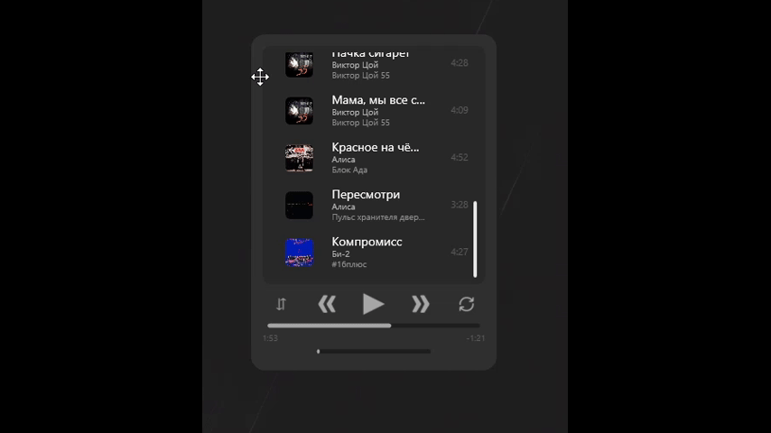

# DesktopMusicWidget
Специальный музыкальный виджет-плеер, находящийся под рукой! Обязательно прочитайте README.md (хотя-бы первый пункт) перед использованием!

# Как использовать?
✥ Для перемещения виджета зажмите правый Shift и нажмите три раза по виджету до момента пока не услышите определённый звук использующийся для уведомления. 

🔒 Как только вы выбрали позицию где должен стоять виджет, используйте комбинацию правый Shift + Enter и его позиция сохраниться.

➕ Для добавления какого-либо трека, просто перетаскивайте его из папки в блок отвечающий за показ плейлиста.

➖ Для удаления трека из плейлиста, наведитесь на него и в поле где показывается его продолжительность появиться крестик. Нажав на него, трек удалиться из списка.
.

🔃 Для изменения порядка прослушивания, просто нажмите на кнопку .

🔁 Для зацикливания одного трека, активируйте кнопку .

⏪ Для прослушивания прошлого трека, нажмите на .

⏩ Для прослушивания следующего трека, используйте .

▶️ Для начала воспроизведения/остановки трека, нажмите на .

# Требования
Иметь .NET 8 
на этом всё.

# Комментарии
С этим виджетом вы можете делать что угодно! Я его делал исключительно для себя и своих друзей, которым будет это интересно. Исходники есть в разделе релизов. Если вы будете говорить что это ИИ-мусор, то с большой вероятностью вы будете правы. Если кто-то сможет сделать виджет лучше - будет очень хорошо! Я надеюсь что это кого-то заинтересует и появиться адекватный виджет-плеер для Windows. 

В будущем вероятнее всего будут обновления в виде возможности кастомизации виджета и добавления больше функций. 
