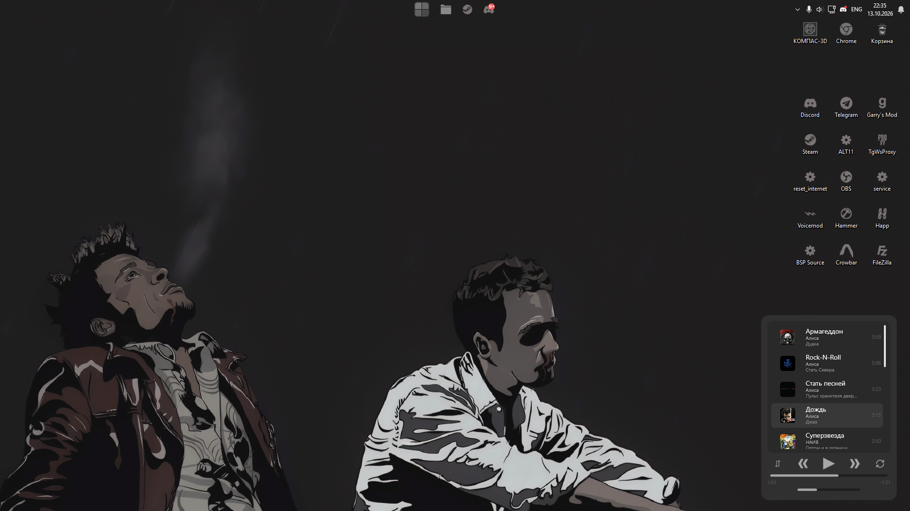

# DesktopMusicWidget
### RU
Специальный музыкальный виджет-плеер, находящийся под рукой! Обязательно прочитайте README.md (хотя-бы первый пункт) перед использованием!

# Как использовать?
✥ Для перемещения виджета зажмите правый Shift и нажмите три раза по виджету до момента пока не услышите определённый звук использующийся для уведомления. 

🔒 Как только вы выбрали позицию где должен стоять виджет, используйте комбинацию правый Shift + Enter и его позиция сохраниться.

➕ Для добавления какого-либо трека, просто перетаскивайте его из папки в блок отвечающий за показ плейлиста.

➖ Для удаления трека из плейлиста, наведитесь на него и в поле где показывается его продолжительность появиться крестик. Нажав на него, трек удалиться из списка.

🔃 Для изменения порядка прослушивания, просто нажмите на кнопку .

🔁 Для зацикливания одного трека, активируйте кнопку .

⏪ Для прослушивания прошлого трека, нажмите на .

⏩ Для прослушивания следующего трека, используйте .

▶️ Для начала воспроизведения/остановки трека, нажмите на .

# Требования
Иметь .NET 8 
на этом всё.

# Комментарии
С этим виджетом вы можете делать что угодно! Я его делал исключительно для себя и своих друзей, которым будет это интересно. Исходники есть в разделе релизов. Если вы будете говорить что это ИИ-мусор, то с большой вероятностью вы будете правы. Если кто-то сможет сделать виджет лучше - будет очень хорошо! Я надеюсь что это кого-то заинтересует и появиться адекватный виджет-плеер для Windows. 

В будущем вероятнее всего будут обновления в виде возможности кастомизации виджета и добавления больше функций. 

# DesktopMusicWidget
### ENG
A special music widget-player, right at your fingertips! Be sure to read the README.md (at least the first point) before using it!

# How to use?
✥ To move the widget, hold down the right Shift and click the widget three times until you hear a specific notification sound.

🔒 Once you've chosen the spot where the widget should be, use the right Shift + Enter combination and its position will be saved.

➕ To add any track, just drag it from the folder into the block responsible for showing the playlist.

➖ To remove a track from the playlist, hover over it and a cross will appear in the field showing its duration. Click on it, and the track will be removed from the list.

🔃 To change the listening order, just press the button .

🔁 To loop a single track, turn on the button .

⏪ To listen to the previous track, click on .

⏩ To listen to the next track, use .

▶️ To start or stop playing a track, press .

# Requirements
Have .NET 8
that's it.

# Comments
With this widget, you can do anything! I made it exclusively for myself and my friends who might find it interesting. The source code is in the releases section. If you say this is AI junk, you're very likely right. If someone manages to make a better widget – that would be great! I hope someone will be interested and a proper widget player for Windows will appear.

In the future, there will most likely be updates in the form of the ability to customize the widget and add more features.
